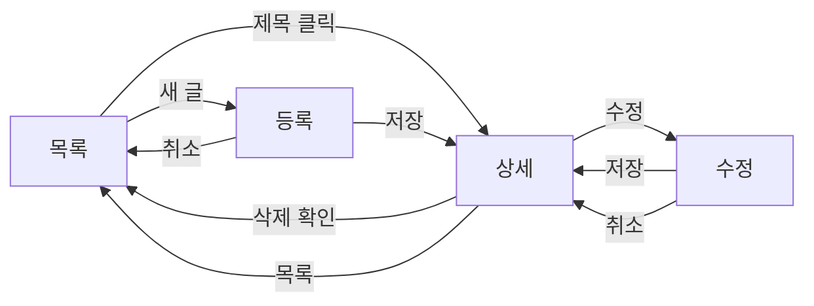

# ENXBoard 게시판 위젯 설계

3D Dashboard용 게시판 위젯의 설계다. 데이터는 서버 없이 `data/posts.json`만 쓴다.
화면 전환은 `App`이 맡고, 조회와 저장은 `Data`가 맡고, 화면은 `View`가 그린다.
구현은 이 폴더의 `index.html`과 `js/`다. 모듈은 ES `import`가 아니라 AMD `define`이다.

| 항목 | 값 |
|---|---|
| 폴더 | `ENXBoard/` |
| 진입 | `index.html` |
| 앱 | `js/app.js`의 `App` |
| 쪽 크기 | `5`. `App`의 `PAGE_SIZE` |
| 데이터 | `data/posts.json`. 실행 중 변경은 메모리에만 남는다 |

## 1. 요구

| 기능 | 동작 |
|---|---|
| 목록 | 제목, 작성자, 날짜, 태그를 표로 보여 준다. 첫 화면이다 |
| 상세 | 제목을 누르면 본문, 작성자, 날짜, 태그를 보여 준다 |
| 등록 | 목록의 새 글에서 제목, 작성자, 날짜, 본문, 태그를 저장한다 |
| 수정 | 상세에서 같은 입력으로 기존 글을 고친다 |
| 삭제 | 상세에서 확인 뒤 글을 없애고 목록으로 돌아온다 |
| 쪽 나눔 | 한 쪽 5건. 이전, 다음. 검색 결과 개수에 맞춘다 |
| 검색 | 제목, 작성자, 본문, 태그에 대해 대소문자를 구분하지 않는다. 검색하면 1쪽으로 돌아간다 |

제목, 작성자, 본문이 비어 있으면 저장하지 않고 입력 화면에 이유를 보여 준다. 날짜가 있으면 `YYYY-MM-DD`만 받는다. 날짜를 비우면 등록 시 오늘 날짜를 넣는다.

## 2. 화면 흐름



목록이 입구다. 행은 상세로만 간다. 상세에서 수정과 삭제로 갈라진다. 등록은 목록에서 시작한다.

## 3. 모듈 경계

한 모듈은 한 가지 책임만 가진다. 파일은 `js/`에 있다.

| 모듈 | 파일 | AMD ID | 책임 |
|---|---|---|---|
| App | `js/app.js` | `DS/ENXBoard/js/app` | 화면 상태와 전환. 명령을 `Data`에 넘긴다 |
| Data | `js/data.js` | `DS/ENXBoard/js/data` | 목록, 상세, 등록, 수정, 삭제의 호출. 지금은 목 데이터 |
| Model | `js/model.js` | `DS/ENXBoard/js/model` | 글 하나. 기본값, 검사, JSON |
| Collection | `js/collection.js` | `DS/ENXBoard/js/collection` | 글 목록. 추가, 삭제, id 찾기, 검색과 쪽 |
| View | `js/view.js` | `DS/ENXBoard/js/view` | 템플릿에 데이터를 넣어 그리고, 입력을 명령으로 올린다 |

`Data`만 `Collection`과 `Model`을 만든다. `View`는 `Data`를 부르지 않는다.

파일 하나에 `define`이 하나다. 저장소의 `Publication.js`처럼 생성자와 `prototype` 메서드를 반환한다. `UWA`나 `DS/UIKIT`, `DS/Controls`는 이 예에 넣지 않는다.

| 모듈 | 의존성 | 반환 |
|---|---|---|
| `DS/ENXBoard/js/model` | 없음 | `Post` |
| `DS/ENXBoard/js/collection` | `DS/ENXBoard/js/model` | `Collection` |
| `DS/ENXBoard/js/data` | `collection`, `model` | `Data`. `load`, `fetchList`, `fetchDetail`, `createPost`, `updatePost`, `deletePost` |
| `DS/ENXBoard/js/view` | 없음 | `View`. `render` |
| `DS/ENXBoard/js/app` | `data`, `view` | `App`. `init`, `showList`, `showDetail` |

`index.html`은 `js/loader.js`를 먼저 읽는다. 이 파일은 `define`과 `require`만 제공한다. `DS/ENXBoard/` 뒤를 이 폴더의 상대 경로로 바꿔 스크립트를 넣고, 의존 모듈이 정의된 뒤에 factory를 호출한다. 외부 CDN은 쓰지 않는다. 페이지는 `require(["DS/ENXBoard/js/app"], ...)`로 `App`을 만들어 `init`한다.

## 4. 패턴

준 MVC다. 데이터와 화면을 나누고, `App`이 컨트롤러다.

| 자리 | 모듈 |
|---|---|
| 모델 | `Model` 한 건, `Collection` 목록 |
| 뷰 | `View` |
| 컨트롤러 | `App` |
| 서비스 | `Data`. 컨트롤러와 모델 사이에 둔다 |

버튼을 모듈로 만들지 않는다. 화면의 클릭은 명령 이름만 올린다. `App`이 그 이름을 보고 `showList`, `showDetail`, `Data`의 메서드를 고른다.

## 5. 메서드

### App

| 메서드 | 하는 일 |
|---|---|
| `init` | `Data.load`로 JSON을 읽고 `showList` |
| `showList` | `fetchList({ page, pageSize, query })` 결과로 목록 화면 |
| `showDetail(id)` | `fetchDetail` 결과로 상세 화면 |

등록, 수정, 삭제, 검색, 쪽 이동은 `View`가 올린 명령이다. `App._onCommand`가 받는다.

| 명령 | 다음 |
|---|---|
| `search` | 검색어를 저장하고 1쪽에서 `showList` |
| `page` | 쪽 번호를 바꾸고 `showList` |
| `open` | `showDetail` |
| `create` | 빈 입력 화면 |
| `edit` | 상세를 다시 읽은 뒤 수정 화면 |
| `delete` | 확인 뒤 `deletePost`, 그리고 `showList` |
| `save` | `createPost` 또는 `updatePost`. 성공하면 `showDetail` |
| `back` | `showList` |
| `cancel` | 수정이면 상세, 등록이면 목록 |

### Data

모두 Promise를 반환한다. 실패는 reject다. 검사 실패의 값은 `{ ok: false, errors }`다.

| 메서드 | 하는 일 |
|---|---|
| `load(source)` | 배열 또는 `posts.json`을 `Collection`에 넣는다 |
| `fetchList({ page, pageSize, query })` | `Collection.getPage` |
| `fetchDetail(id)` | `findById`. 없으면 reject |
| `createPost(raw)` | `Post`를 검사하고 `add`. id는 `p`와 두 자리 번호 |
| `updatePost(id, raw)` | 검사에 통과한 뒤에만 기존 글에 반영 |
| `deletePost(id)` | `remove` |

### Model

`Post` 생성자의 기본값은 빈 문자열과 빈 태그 배열이다.

| 메서드 | 하는 일 |
|---|---|
| `validate` | `{ ok, errors }`. 제목, 작성자, 본문 필수. 날짜 형식 |
| `toJSON` | 앞뒤 공백을 뺀 `{ id, title, author, date, content, tags }` |

### Collection

| 메서드 | 하는 일 |
|---|---|
| `add` | 목록 끝에 `Post`를 넣는다 |
| `remove(id)` | 빼낸 글. 없으면 `null` |
| `findById(id)` | 글 또는 `null` |
| `getPage(page, pageSize, query)` | 검색 뒤 날짜 내림차순으로 자른다. `{ items, page, pageSize, total, pageCount }` |

`items`는 `toJSON` 결과다. 쪽 번호는 1부터다. 범위를 벗어나면 안쪽 쪽으로 맞춘다. 0건이어도 `pageCount`는 1이다.

### View

`render(state)`가 `#board` 안을 다시 그린다. `state`는 `{ screen, query, list, post, errors, notice }`다.

클릭과 제출은 `data-command`로 받는다. `onCommand(name, payload)`만 호출한다. 저장 명령의 `payload.fields`는 입력값이다. 검색 명령의 `payload.query`는 검색 칸이다.

## 6. 한 방향

```text
View  --명령-->  App  --메서드-->  Data  --목록-->  Collection  --한 건-->  Post
View  <--state--  App  <--JSON----  Data
```

`View`의 `define` 의존성에는 `Data`와 `Collection`이 없다. 사용자 입력은 명령으로만 올라간다. `App`이 `Data`에 넘긴다. `Data`가 목 저장소를 고친 뒤 JSON을 돌려주면 `App`이 `View.render`에 상태를 넘긴다.

## 7. 공통 모듈

아이콘과 표에 대해 ENXScene이 이미 쓰는 모듈을 먼저 찾았다.

| 필요한 UI | 저장소에 있는 것 | 이 페이지에서 |
|---|---|---|
| 아이콘 | `Core/wux-3ds-fonticons.css`의 `DSFontIcon`. 클래스 `wux-ui-3ds`, `wux-ui-3ds-list`, `wux-ui-3ds-search`, `wux-ui-3ds-plus`, `wux-ui-3ds-pencil`, `wux-ui-3ds-trash`, `wux-ui-3ds-left`, `wux-ui-3ds-check` | `index.html`이 이 CSS를 불러 오고 `View`가 `<i>`에 클래스를 붙인다. 글립은 `Core/assets/fonts/3ds_fonticon.*` |
| 아이콘 위젯 | `ENXScene/docs/readable/common/UIKIT/UIKIT.js`의 `DS/UIKIT/Image`. README에 `DS/UIKIT/Iconbar`가 있다 | 기동하지 않는다. `UWA/Core`, `UWA/Class`가 있어야 하고, 이 폴더의 정적 페이지에는 그 로더가 없다 |
| 표 그리드 | `DS/ENXNav/views/xNavDataGridView`가 `DS/DataGridView/DataGridView`를 require한다. 구현은 `webapps_2025x/DataGridView/DataGridView.js` | 기동하지 않는다. UWA, TreeModel, Controls, `i18n!` 플러그인, 대시보드 로더가 없다. 그리드 모듈을 새로 만들지 않았다 |
| 트리 그리기 | `DS/etree/tree` | 표가 아니다. HTML이 올리는 그래프·트리 런타임이라 목록에 쓰지 않는다 |
| 표 스킨 | `Core/wux.css`의 `.wux-layouts-datagridview` | 위젯이 만든 DOM에 붙는 규칙이다. 정적 표에 클래스만 얹으면 그리드가 되지 않아 링크하지 않았다 |

그래서 목록 표의 행과 칸은 `View`가 그린다. 아이콘만 공통 폰트 CSS를 재사용한다. 대시보드 iframe에서 같은 목록을 `xNavDataGridView`로 바꿀 때는 `Data.fetchList`가 돌려주는 `items`를 열 데이터로 넣으면 된다. 열은 제목, 작성자, 날짜, 태그다.

## 8. 목 데이터

파일은 `data/posts.json`이다. 글 12개라 쪽 크기 5에서 3쪽이 된다. `김하준`은 두 건, `보기`는 제목과 태그에 걸쳐 두 건 이상이다. 필드 없는 응답은 `Post` 기본값으로 채운다.

```json
[
  { "id": "p01", "title": "환영 패널이 남는 조건", "author": "김하준", "date": "2026-03-02", "content": "저장 대상이 없고 자동 재적재가 꺼져 있으면 목록 대신 환영 패널이 남는다. 보안 컨텍스트가 비어 있으면 그 전에 조회를 시작하지 않는다.", "tags": ["초기화", "보안"] },
  { "id": "p02", "title": "기본 보기는 데이터 그리드", "author": "박서연", "date": "2026-03-04", "content": "2025x에서 트리 목록 요청은 데이터 그리드로 바뀐다. 보기 키는 위젯 값에 남고, 다시 열면 그 보기가 유지된다.", "tags": ["보기"] },
  { "id": "p03", "title": "저장한 루트가 다시 열리는 경로", "author": "김하준", "date": "2026-03-06", "content": "제품을 열면 저장 맵에 경로가 쌓인다. 자동 재적재가 켜져 있으면 다음 시작에서 그 맵으로 세션을 다시 연다.", "tags": ["저장"] },
  { "id": "p04", "title": "새로고침은 한 번으로 모은다", "author": "이도윤", "date": "2026-03-08", "content": "대시보드 새로고침은 막을 친 뒤 1초 디바운스로 본문 새로고침을 호출한다. 연속 클릭이 조회를 여러 번 내보내면 안 된다.", "tags": ["새로고침"] },
  { "id": "p05", "title": "버튼은 명령 JSON이 가리킨다", "author": "최민재", "date": "2026-03-11", "content": "액션 바의 버튼은 명령 id와 AMD를 JSON에 둔다. 실행 객체는 execute 하나만 가지고, 그때의 모델과 앱을 인자로 받는다.", "tags": ["명령"] },
  { "id": "p06", "title": "보안 컨텍스트 다음에 조회", "author": "정하늘", "date": "2026-03-14", "content": "공유 설정의 보안 컨텍스트가 채워진 뒤에 구조 조회가 나간다. 값이 없으면 준비 이벤트까지 기다린다.", "tags": ["보안"] },
  { "id": "p07", "title": "링크로 연 대상은 처리 뒤 지운다", "author": "한유진", "date": "2026-03-18", "content": "콘텐츠 ID가 있으면 권한 있는 대상으로 푼 뒤 종류를 적재한다. 처리가 끝나면 그 위젯 값은 비운다.", "tags": ["링크"] },
  { "id": "p08", "title": "환경설정 읽기 실패는 실패 화면", "author": "박서연", "date": "2026-03-21", "content": "환경설정 저장소를 읽는 것 자체가 실패하면 실패 본문을 보여 준다. 저장소가 비어 기본 키로 가는 것과 구분한다.", "tags": ["환경설정"] },
  { "id": "p09", "title": "관계 열은 설정이 켜질 때만", "author": "오세준", "date": "2026-03-25", "content": "관계 열 모듈은 추가 열 Promise가 끝난 뒤에 그리드에 붙는다. 설정이 꺼져 있으면 그 모듈을 올리지 않는다.", "tags": ["열"] },
  { "id": "p10", "title": "그래프 보기에는 상한이 있다", "author": "이도윤", "date": "2026-03-28", "content": "그래프 노드와 경로에는 상한이 있다. 데이터 그리드와 그래프는 같은 트리 문서를 다른 보기로 그린다.", "tags": ["보기", "그래프"] },
  { "id": "p11", "title": "실패해도 준비 이벤트는 난다", "author": "정하늘", "date": "2026-04-02", "content": "속성 초기화나 앱 초기화가 실패하면 실패 본문이 보인다. 준비 이벤트는 그때도 발생하고 인자는 앱 인스턴스다.", "tags": ["실패"] },
  { "id": "p12", "title": "별칭은 이 위젯 URL만 작업 폴더를 본다", "author": "최민재", "date": "2026-04-06", "content": "로더가 받는 파일은 실행 묶음이다. 콘솔의 받은 주소가 작업 폴더가 아니면 별칭이 아직 이 위젯을 가리키지 않는 것이다.", "tags": ["개발"] }
]
```

## 9. 구현 순서

바깥에서 안으로 만든다. 각 단계의 확인이 된 뒤에 다음 단계 파일을 더한다.

| 단계 | 만드는 것 | 확인 |
|---|---|---|
| 0 뼈대 | `index.html`, 빈 `#board` | 정적 서버로 열면 제목 ENXBoard가 보인다 |
| 1 껍질 | `css/board.css`, 아이콘 CSS 링크 | 새로고침 뒤 아이콘 글꼴 요청이 `Core/assets/fonts/3ds_fonticon`으로 간다 |
| 2 초기화 | `App.init`, `View`의 빈 목록 | 본문에 목록 제목과 새 글, 검색 칸이 있다. 행은 없어도 된다 |
| 3 데이터 | `Model`, `Collection`, `Data`, `posts.json` | `load` 뒤 `fetchList`가 5건, `김하준` 검색이 2건, `fetchDetail("p01")`이 한 건 |
| 4 화면 연결 | 명령 바인딩, 상세, 등록, 수정, 삭제, 쪽 | 제목으로 상세, 수정 저장, 삭제 후 목록, 빈 제목은 저장되지 않음 |

`DataGridView`를 이 순서에 넣지 않는다. 7절의 기동 조건이 갖춰진 대시보드에서만 목록 호스트를 그 뷰로 바꾼다.

## 10. 나중에 바꾸기 쉬운 경계

| 경계 | 지금 | 바꿀 때 유지할 계약 |
|---|---|---|
| `Data.load` / `fetchList` / `fetchDetail` / `createPost` / `updatePost` / `deletePost` | 메모리와 JSON | 메서드 이름과 Promise, JSON 필드. 주소만 서버로 바꾼다 |
| `PAGE_SIZE` | `5` | `fetchList`의 `pageSize` |
| 명령 이름 | `search`, `page`, `open`, `create`, `edit`, `delete`, `save`, `back`, `cancel` | `View`와 `App`이 이 문자열을 공유한다 |
| 글 필드 | `id`, `title`, `author`, `date`, `content`, `tags` | `Post.toJSON` |
| 목록 UI | `View`의 표와 `wux-ui-3ds` 아이콘 | 행 클릭은 `open`과 id. 그리드 위젯으로 바꿔도 명령은 같다 |

로컬과 StackBlitz에서는 이 저장소 루트가 서버 루트다. 아이콘은 `vendor/core`에 있다.

```text
npm install
npm run dev
```

브라우저 주소는 서버가 출력한 주소의 `/`다. `file://`로 열면 `fetch`가 JSON을 읽지 못한다.

## 11. 목 대시보드 셸

`mock-shell.html`은 3D Dashboard 부모 창이다. 위젯 소스(`js/`, `index.html`)는 그대로 두고, 부모가 제공하던 객체만 이 파일이 대신한다. 브라우저에서 `mock-shell.html`을 연다. 글 목록은 iframe 안의 `index.html`이 JSON을 `fetch`하므로, 10절과 같이 정적 서버로 열면 글이 보인다.

| 부모 API | 하는 일 |
|---|---|
| `window.parent.appId` | `"ENXBoard"` |
| `window.parent.widget` | 위젯 인스턴스. `id`, `appId`, `title`, `getValue`, `setValue`, `deleteValue`, `addEvent`, `setTitle` |
| `window.parent.dashboard` | `{ appId, widget, postToWidget(type, data) }` |
| `postMessage` | 부모가 iframe에 `{ source: "3DDashboard", appId, widgetId, type, data }`를 보낸다. iframe이 같은 형태로 보내면 부모가 `setTitle`과 `addEvent` 핸들러에 전달한다 |

패널 iframe은 `index.html`이고 크기는 800×600이다. 제목 막대 문구는 `ENXBoard`다. `widget.setTitle` 또는 `{ type: "setTitle", title }` 메시지가 오면 그 문구가 바뀐다. iframe이 로드되면 부모가 `type: "onLoad"` 메시지를 한 번 보낸다. 지금 위젯 코드는 부모를 읽지 않으므로, 셸이 있어도 목록 동작은 `index.html`을 직접 열 때와 같다.
